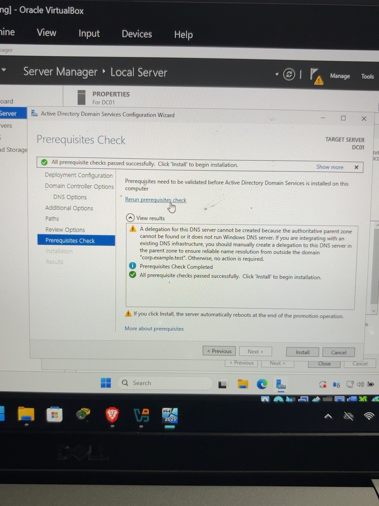
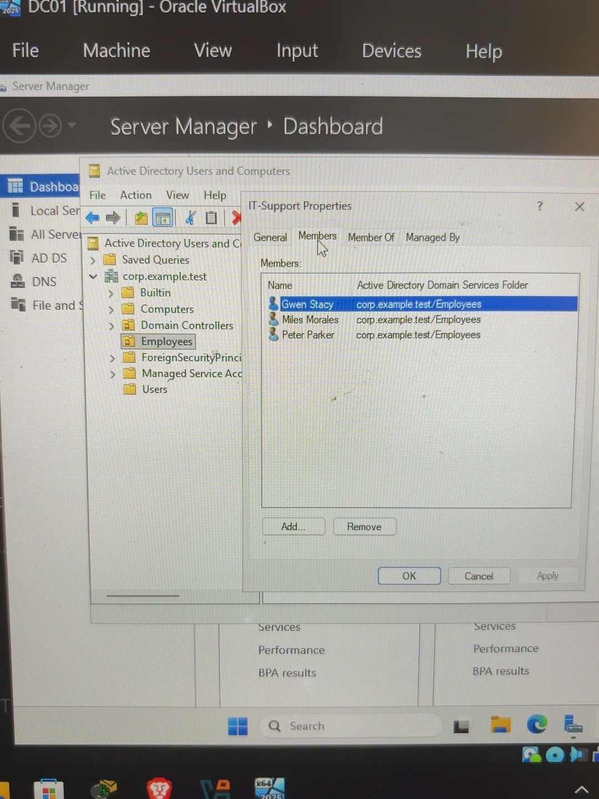
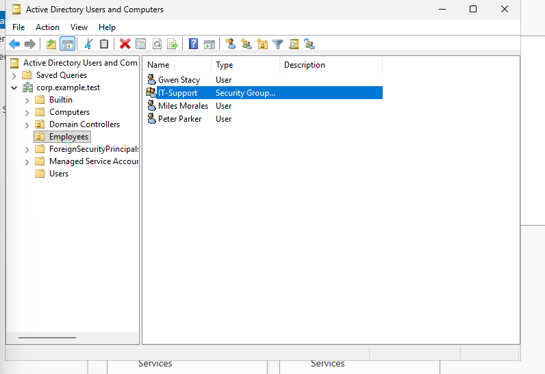
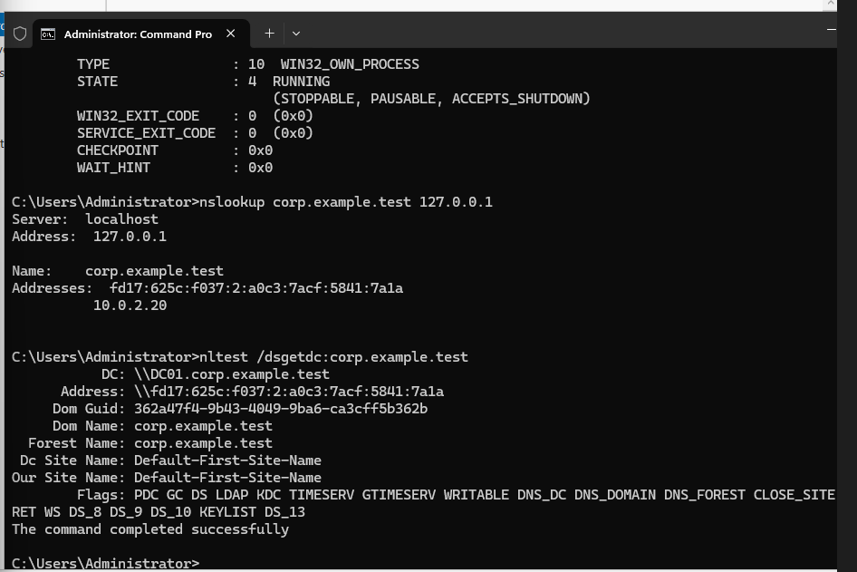
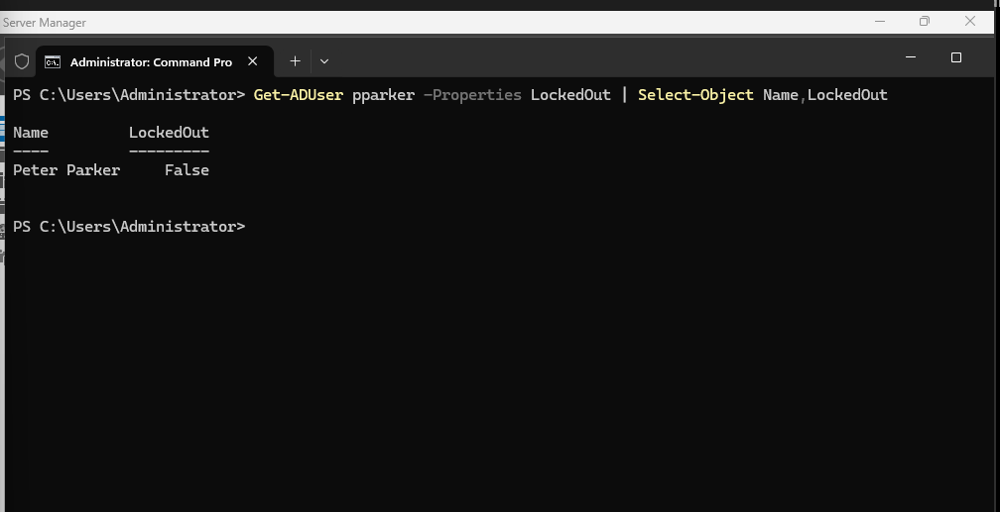
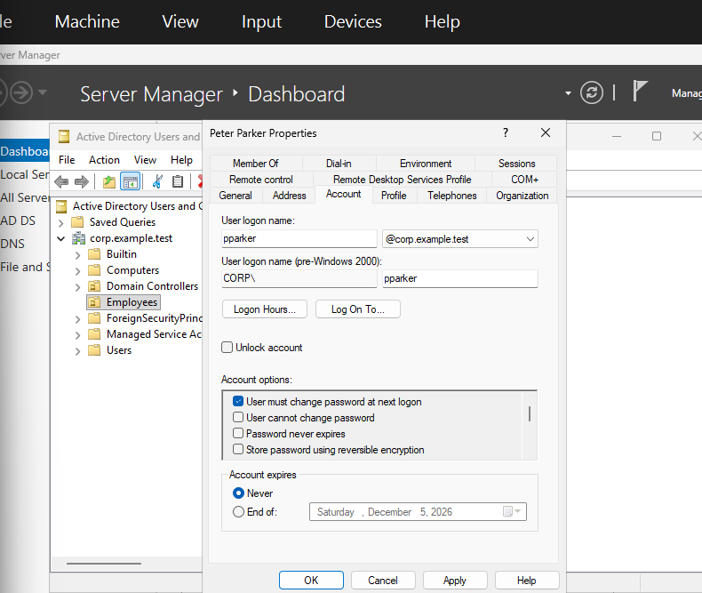

# Active Directory Home Lab

## Project Overview
This project documents my hands-on experience building a Windows Server 2025 Active Directory lab using Oracle VirtualBox. The goal is to develop practical IT support, Windows Server administration, networking, and identity management skills.

## Lab Environment
- Virtualization: Oracle VirtualBox
- Operating System: Windows Server 2025
- Server Name: DC01
- Active Directory Domain: corp.example.test
- Network Configuration: NAT
- Static IPv4 Address: 10.0.2.15
- Subnet Mask: 255.255.255.0
- Default Gateway: 10.0.2.2
- Preferred DNS Server: 10.0.2.15

## Work Completed
1. Configured a Windows Server 2025 virtual machine in VirtualBox.
2. Configured a static IPv4 address and DNS settings.
3. Installed the Active Directory Domain Services role.
4. Configured a new Active Directory forest named corp.example.test.
5. Passed the domain controller prerequisite checks.
6. Started domain controller promotion and observed the server restart.
7. Verified successful domain controller promotion using Active Directory Users and Computers.
8. Created an Employees organizational unit (OU).
9. Created and managed domain user accounts.
10. Performed a password reset with a required password change at next logon.
11. Disabled and re-enabled a user account.
12. Created an IT-Support global security group.
13. Added three users to the security group and verified their membership.
## Next Steps

- [ ] Validate Active Directory DNS functionality.
- [ ] Simulate and troubleshoot locked user accounts.
- [ ] Practice unlocking accounts in Active Directory.
- [ ] Create additional organizational units and security groups.
- [ ] Explore Group Policy Objects (GPOs).
- [ ] Document troubleshooting procedures and add supporting screenshots.

## Project Status
In progress — Windows Server 2025 domain controller deployed and Active Directory user and group management exercises completed. Additional DNS validation, account troubleshooting, and access management labs planned.
## Lab Screenshots

### Active Directory Prerequisites Check


## Active Directory User and Group Management

### User Account Management
- Created an Employees organizational unit (OU) to organize domain user accounts.
- Provisioned test user accounts for Peter Parker, Miles Morales, and Gwen Stacy.
- Practiced resetting user passwords and requiring password changes at next logon.
- Disabled and re-enabled a user account to simulate temporary employee leave.
- Deleted an unused test account.

### Security Group Management
- Created an IT-Support global security group.
- Added three domain users to the security group.
- Verified group membership using Active Directory Users and Computers.

### Skills Practiced
- Active Directory Domain Services (AD DS)
- User provisioning and account lifecycle management
- Password administration
- Security group creation and membership management
- Basic identity and access management (IAM)
### Security Group Membership Verification


### Employees Organizational Unit

The Employees OU contains three test user accounts and the IT-Support security group.


## DNS Troubleshooting and Domain Controller Verification

### Objective
Verify that the Windows Server 2025 domain controller can resolve the Active Directory domain and be discovered by domain services.

### Troubleshooting Steps
1. Ran `nslookup corp.example.test` and observed DNS request timeouts.
2. Used `ipconfig /all` to inspect the server's network configuration and DNS settings.
3. Confirmed the DNS service was running using `sc query DNS`.
4. Ran `nslookup corp.example.test 127.0.0.1` to test DNS resolution directly through the local IPv4 DNS service.
5. Ran `nltest /dsgetdc:corp.example.test` to verify domain controller discovery.

### Results
- DNS service status: RUNNING.
- Local IPv4 DNS lookup: Successful.
- Domain resolved to IPv4 address `10.0.2.20`.
- Domain controller DC01 was successfully discovered.
- Domain controller discovery returned `The command completed successfully`.
- Initial DNS timeouts remain under investigation.

### Evidence


### Skills Practiced
- Windows Server DNS troubleshooting
- Command-line network diagnostics
- Active Directory domain controller discovery
- Troubleshooting and verification documentation
## Active Directory Account Lockout Troubleshooting

### Objective
Simulate an Active Directory account lockout, identify the issue, restore user access, and verify the resolution.

### Lab Environment
- Windows Server 2025
- Active Directory Domain Services (AD DS)
- Domain: `corp.example.test`
- Test user: Peter Parker (`pparker`)

### Troubleshooting Steps
1. Configured a domain account lockout threshold of five failed login attempts.
2. Simulated unsuccessful authentication attempts using an incorrect test password.
3. Used PowerShell to inspect the user's failed login count and account lockout status.
4. Confirmed the account was locked (`LockedOut = True`).
5. Opened Active Directory Users and Computers (ADUC) and manually unlocked the account.
6. Verified the account was no longer locked (`LockedOut = False`).

### Verification

The following PowerShell command confirmed that the account was unlocked:

```powershell
Get-ADUser pparker -Properties LockedOut | Select-Object Name,LockedOut
```

**Result:** `LockedOut = False`



### Skills Practiced
- Active Directory user account management
- Account lockout policy configuration
- Authentication troubleshooting
- PowerShell account status verification
- Help Desk incident resolution and documentation

### Key Takeaway
This lab demonstrated how to investigate and resolve an Active Directory account lockout, a common issue handled by IT Help Desk and Service Desk technicians.
## Active Directory Password Reset Lab

### Objective
Simulate a common Help Desk request by resetting a user's password and verifying their account settings in Active Directory.

### Tasks Completed
- Reset a test user's password using Active Directory Users and Computers (ADUC).
- Enabled **User must change password at next logon**.
- Verified the user account was enabled.
- Confirmed the password reset completed successfully.

### Verification
Active Directory confirmed the password reset was successful. The account properties showed that the user was required to change their password at the next login and that the account remained enabled.



### Skills Practiced
Active Directory user management, password resets, account verification, and Help Desk troubleshooting.

**Note:** An actual user login was not tested.
